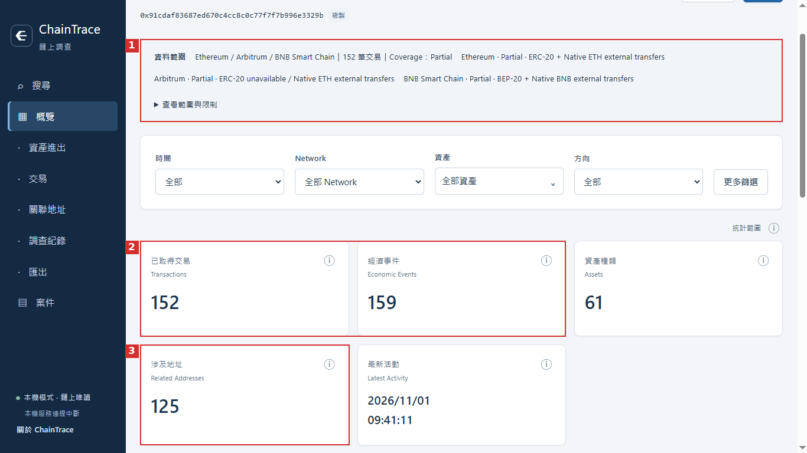
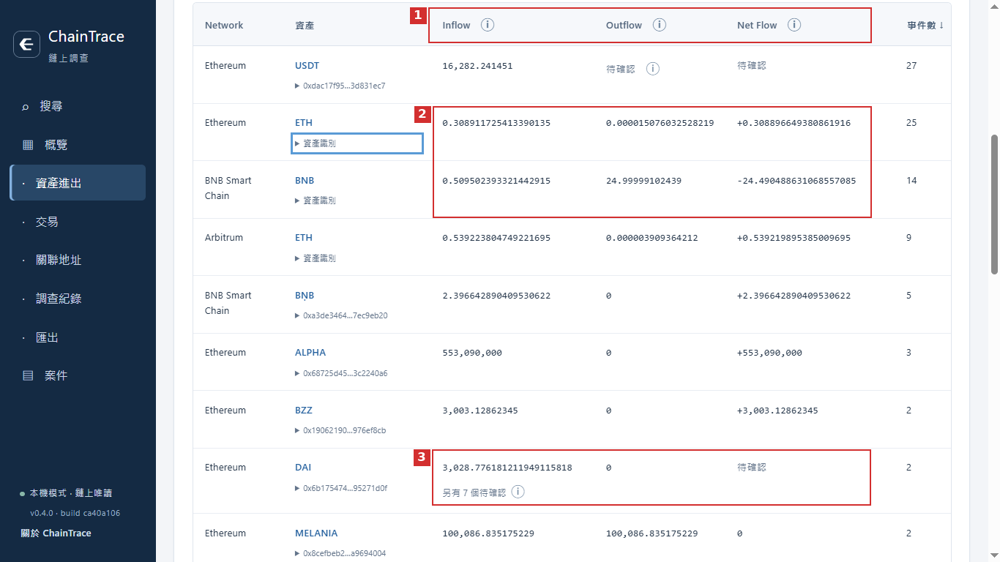
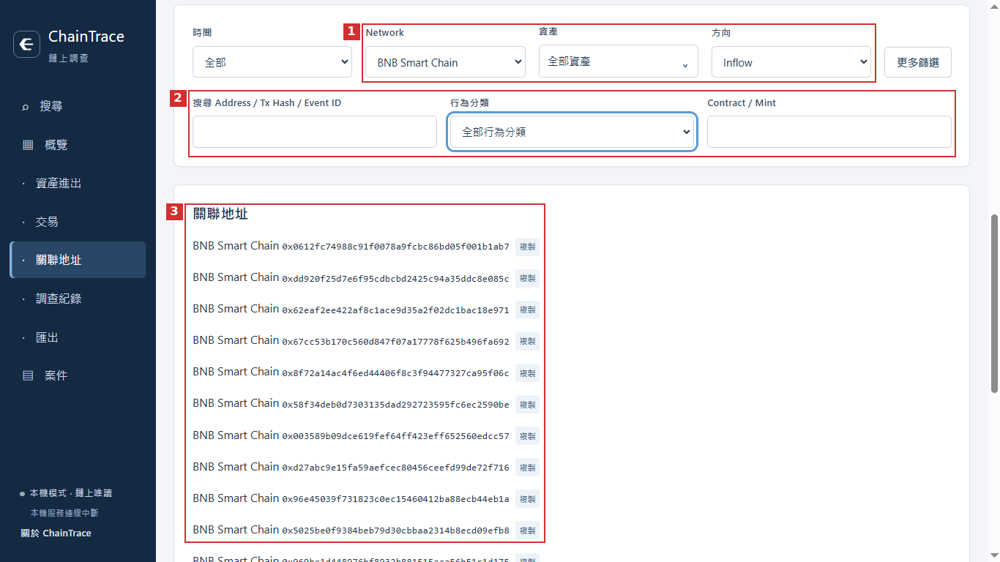

# ChainTrace

> 多鏈鏈上金流分析與調查工具，保留可核對的交易證據，並交代分析結果的適用範圍。

我是從鏈上金流調查的實際需求出發，規劃並透過 AI 輔助開發 ChainTrace。它將不同區塊鏈上的交易資料整理成一致的分析格式，用來查看地址的資金流入、流出、交易對手，以及可能的後續資金去向。

研究鏈上案件時，我經常遇到幾個問題：各條鏈的資料結構不同；一筆交易可能包含不只一筆資產轉移；資金經過 Swap、Router 或 Bridge 後，也容易在整理紀錄時被重複計算。我希望把這些處理步驟做成可重複使用的工具，並且讓每項分析結果都能回頭核對交易與查詢條件。

目前開發版本包含 CLI、FastAPI 後端、React 前端與 Windows 封裝程式。不同網路的支援範圍仍有差異，詳細列在下方。

**公開範圍**：這個 GitHub Repository 目前用於展示專案與技術文件，尚未公開完整原始碼、安裝包或可供外部重跑的測試環境。本文所列的既有功能與測試，依據本機開發版本 `2f9d677`（2026/11/05）的保存紀錄整理；它不是這個公開 Repository 的 Commit。BNB One-Hop／Multi-Hop 尚未在該版本完成與驗證。下列操作截圖另行提供，不能據此更新既有測試結論。

### 操作畫面：調查概覽



圖 1：① 查看網路、查詢範圍與 Coverage；② 分別呈現交易筆數與經濟事件數；③ 查看涉及地址數量。畫面顯示的是目前取得的資料，Coverage 為 `Partial`，不代表完整交易歷史。左下角仍有「本機服務連線中斷」提示，此圖僅展示已呈現的查詢結果，不能作為服務連線正常的驗證。

## 主要功能

### 資金流入與流出分析

- **Inflow / Outflow / Net Flow**：依資產分別計算流入、流出及淨流量。
- **Counterparty Analysis**：整理往來地址、交易次數、資產數量與集中度，協助辨識值得進一步查看的交易對手。
- **Canonical Data Model**：將不同公鏈的資料正規化為共同格式，同時保留各鏈特有的交易資訊。
- **Amount Precision**：以原始整數金額與 `decimals` 計算資產數量，避免主要計算過程使用浮點數。
- **Query Scope / Coverage**：保留查詢範圍、資料量及限制，讓使用者知道分析結果涵蓋哪些紀錄。



圖 2：① 依欄位比較 Inflow、Outflow 與 Net Flow；② 分開查看 Ethereum ETH 與原生 BNB 的數量；③ 保留 DAI 的待確認資訊。「待確認」不能解讀成零或已確認餘額；相同代幣符號也不能直接合併，仍須核對網路與資產識別。

此圖左下角標示 `v0.4.0 · build ca40a106`，並顯示 Native ETH／BNB 資料，與本文依據的 `2f9d677` 支援範圍不同。這裡保留實際畫面，不據此宣稱原生資產追蹤已通過驗證；版本差異仍待核對。

### 關聯地址與篩選



圖 3：① 以 BNB Smart Chain 與 Inflow 篩選；② 顯示地址、交易識別、行為分類及 Contract／Mint 等篩選欄位；③ 列出目前條件下的關聯地址。這張圖沒有逐跳路徑或交易連結證據，不能當成 Multi-Hop 成果，也不能由地址清單推定控制權或受害者身分。此圖未顯示完整查詢地址，不能僅憑畫面認定它與其他截圖屬於同一案件。

### 單跳與多跳候選追蹤

ChainTrace 可從已知來源交易出發，根據資產、時間及其他查詢條件，找出下一層可能相關的轉出紀錄，再以有界的 BFS（Breadth-First Search）延伸多層候選路徑。

追蹤過程會保留：

- 時間窗、深度、節點、邊、分支、頁數及查詢次數上限。
- Path-local cycle prevention，避免同一路徑反覆展開。
- 地址、合約及程式的分類結果與停止條件。
- 相關交易證據、stop reasons 與 completeness 資訊。
- 查詢不完整或遇到不支援情境時的限制說明。

**如何解讀結果**：系統找到的是 *downstream candidates*。由於代幣具有可替代性，即使兩筆交易在時間與金額上接近，也不足以認定它們移動的是同一批資產。候選路徑必須和已確認的金流證據分開看待。

## 支援網路

以下整理文件記錄版本 `2f9d677` 的功能範圍；操作截圖與該版本的差異，另於圖說交代。

| 網路 | 資產／標準 | 金流分析 | 單跳追蹤 | 多跳追蹤 | 範圍與限制 |
| --- | --- | :---: | :---: | :---: | --- |
| Ethereum | ERC-20 | ✅ | ✅ | ✅ | Native ETH 與 internal movement 尚未整合為通用追蹤功能；分析結果受查詢範圍限制。 |
| Arbitrum | ERC-20 | ✅ | ✅ | ✅ | 已有真實資料查詢紀錄；跨鏈路徑仍須逐一驗證。 |
| TRON | TRC-20 / native TRX | ✅ | ✅ | ✅ | 支援有界分析，已有歷史樣本；最新版本尚未重新完成全面 live validation。 |
| Solana | SPL Token / native SOL | ✅ | ✅ | ✅ | 支援有界追蹤，Token Account 歷史資料可能不完整。 |
| BNB Smart Chain | BEP-20 | ✅ | 尚未完成 | 尚未完成 | BEP-20 One-Hop／Multi-Hop 尚待完成與驗證；目前 `2f9d677` 尚未提供。Native BNB、internal transactions 與通用 protocol decoding 不在本次範圍。 |

其他網路的 ✅ 代表已有相應實作與測試紀錄。

### 各鏈資料處理

**Ethereum / Arbitrum**

目前以 ERC-20 分析為主，透過 EVM Provider / Adapter 處理資料查詢、正規化與地址分類。合約地址在最新區塊的狀態，不一定等於歷史交易發生當下的狀態。

**TRON**

分別處理 TRC-20 與 native TRX，包含 Base58Check 地址正規化、帳戶類型判斷，以及兩種資產的識別方式。Native TRX 不會使用虛構的 Token Contract Address。

**Solana**

處理 SPL Token、Token-2022、native SOL，以及 versioned transactions、inner instructions / CPI。分析時會區分 Wallet Owner、Token Account、Program、PDA / Off-curve Address 與 System Account，避免把不同地址角色直接當成同一個控制者。

**BNB Smart Chain**

透過 Alchemy 取得 BEP-20 雙向轉帳資料，進行 event normalization、deduplication、flow 分析，並將結果呈現在 Search / UI。規劃完成後，One-Hop 與 Multi-Hop 也將在指定的時間窗與查詢上限內，找出 BEP-20 downstream candidates。**截至 `2f9d677`，後兩項尚未實作與驗證。**這部分不涵蓋 Native BNB、internal transactions 或通用協定解碼。

## 跨鏈解析

ChainTrace 已建立不依賴單一協定的 Cross-chain Resolution Core，並實作 **Across、Mayan / Swift V2、Symbiosis** 特定路由的 resolver。目前有程式與測試紀錄，但不能用這些結果推定所有協定、鏈別或轉移方向都能解析。

跨鏈事件使用下列狀態記錄處理進度：

`RESOLVED` · `PENDING` · `AMBIGUOUS` · `UNRESOLVED` · `UNSUPPORTED`

證據則區分為 `FACT`、`INFERENCE` 與 `HEURISTIC`。

金額接近、發生時間相近或接收地址相同，都可能是尋找跨鏈交易的線索，但仍屬輔助判斷。要將 Origin Event 與 Destination Event 標記為 `RESOLVED`，還需要符合該協定的可核對證據及唯一性條件。

目前保存了特定 Ethereum → Arbitrum 路由的歷史主網驗證報告；尚未完成所有跨鏈方向、路由與交易情境的最新即時驗證。

## 調查資料與證據

除了基本的交易與金流摘要，較新版本也加入 `EconomicEvent` 模型、案件資料保存、部分來源與歸因分析，以及報告相關流程。

這些功能背後有幾個我在調查時特別重視的判斷原則：

| 概念 | 處理方式 |
| --- | --- |
| **Transfer Record vs. Economic Event** | 同一筆交易可能產生多筆 transfer records，紀錄數量不能直接當成獨立資金事件數。 |
| **Source Address vs. Victim** | 某個地址曾轉出資產，不足以證明地址控制者就是受害者。 |
| **Candidate vs. Confirmed Flow** | 下游候選交易和已有充分證據支持的資金連結分開呈現。 |
| **Router / Swap / Bridge** | 對資產交換、路由及跨鏈行為進行分類，避免未經判斷就重複計入外部資金流入。 |
| **Pending vs. Resolved** | 缺少關鍵來源、目的端或歸因證據時，保留未解狀態。 |

目前部分歸因與防重複計算流程仍與特定研究案件綁定，尚未成為適用所有鏈及協定的通用自動化功能。ChainTrace 也無法單靠鏈上紀錄，自動確認受害者身分、地址所有權或最終損失。

## 系統運作方式

```text
Blockchain Data Providers
          ↓
Chain-specific Adapters / Acquisition
          ↓
Normalization & Canonical Models
          ↓
Flow / Candidate Tracing / EconomicEvent Processing
          ↓
Investigation Results & Evidence / Coverage Metadata
          ↓
CLI · FastAPI · React UI · Windows Application
```

跨鏈解析與案件流程會依各自需要的資料和證據接入，並不是每個模組都已在所有公鏈上完整串接。

Canonical Model 會區分網路、交易、事件、資產及地址角色。各鏈原始識別資訊也會保留，例如 EVM 的 Transaction Hash / Block Number、TRON 的 Transaction ID / Block Number，以及 Solana 的 Signature / Slot。資產不會只憑 Token Symbol 合併，以免不同網路或合約的同名代幣被算在一起。

## 既有驗證紀錄

以下是本機保存的測試與操作紀錄，數字只對應當時的版本和測試範圍。

| 項目 | 保存結果 | 範圍／限制 |
| --- | --- | --- |
| Python regression | **3,598 passed** | `2f9d677`，2026/11/05；108 個測試檔案，0 failures / errors / skipped。 |
| React frontend tests | **179 passed** | 同一版本的前端測試與 build 紀錄。 |
| BSC-specific regression | **40 passed** | 已包含在 3,598 項 Python 測試中，不另加總。 |
| Packaged BSC smoke | **11 transfers / transactions、7 assets** | Windows 封裝程式的有界真實查詢與操作紀錄；不代表完整歷史。 |
| Earlier BSC acquisition smoke | **100 transfers / EconomicEvents、97 transactions** | 另一組歷史樣本，包含 50 inbound / 50 outbound，不與前項合併計算。 |

Ethereum、Arbitrum、TRON、Solana 與特定跨鏈路由也保存有驗證資料。不過，其中部分來自較早版本或有限樣本，並未全部在最新 HEAD 重新執行 Live Validation。

**重現性說明**：這個公開 Repository 尚未提供完整原始碼、測試輸入及執行紀錄，因此外部讀者目前無法僅靠這裡的檔案獨立重跑上述測試。這些數據來自本機保存的驗證報告。

## 調查案例：0x91cd

我曾將 ChainTrace 的部分資料蒐集與處理流程，應用於 **iToken Wallet 0x91cd** 的鏈上調查。保存的 Ethereum 案件資料包括：

- **424** 筆 inflow records（267 external、12 internal、145 ERC-20）。
- **422** 個不同的 Transaction Hashes。
- **306** 個已解析的 upstream source addresses。
- **56** 個 attribution candidates。

這些數字分別代表交易紀錄、交易識別、上游來源與歸因候選，不能互相替代。目前仍沒有足夠證據確認受害者身分或最終損失金額。

這項研究也包含人工判讀、其他分析工具與案件專用腳本，並不是全部透過目前的 ChainTrace 產品介面自動完成。我希望藉由這個案例，說明在整理大量鏈上資料時，如何處理來源辨識、事件去重、資產轉換及尚未解決的證據缺口。

## 目前限制

- **資料範圍**：分析受 Provider、分頁、時間窗及資源上限限制。查詢成功不代表已取得地址的完整交易歷史。
- **各鏈支援程度不同**：BNB 的 BEP-20 One-Hop／Multi-Hop 在文件記錄版本中尚未完成；即使後續完成，也不代表涵蓋 Native BNB、internal transactions 或所有交易類型。
- **跨鏈解析**：目前只支援指定協定與路由，不能假設所有 Bridge 交易都可還原。
- **地址與受害者歸因**：候選金流不能直接證明地址所有權、受害者身分或犯罪損失。
- **Protocol Decoding / Valuation**：尚未提供涵蓋所有協定的通用解碼能力，亦無完整歷史美元估值功能。
- **已知應用問題**：部分 Ethereum 輸入曾出現 URL / Snapshot Validation 問題；GUI 也曾出現連線提示與實際查詢狀態不一致的情況，公開展示前需要再次確認。

## AI 輔助開發

我在規劃需求、撰寫程式及測試時使用了 Codex 等 AI 輔助工具。ChainTrace 實際分析交易時，依靠的是鏈上資料、程式規則與可核對的證據。**目前沒有在執行流程中呼叫 LLM API，也不是自主執行調查的 AI Agent。**

## 專案狀態

- **文件依據**：本機已提交版本 `2f9d677`，2026/11/05（`codex/bug-01-packaged-alchemy-credentials`）；BNB One-Hop／Multi-Hop 在該版本尚未完成與驗證；操作截圖中的較新版本資訊仍待核對。
- **既有功能**：多鏈有界資金分析、部分網路的候選追蹤、特定路由的跨鏈解析、`EconomicEvent` 與案件流程，以及 CLI、FastAPI、React UI、Windows 封裝版本。
- **待完成或驗證**：BNB BEP-20 One-Hop／Multi-Hop、Native BNB / Internal、部分跨鏈 Live Validation、完整歷史覆蓋、通用協定解碼、地址控制權與受害者歸因、完整美元損失估算。
- **公開狀態**：目前 GitHub 主要提供專案介紹與技術文件，尚未發布可供外部下載的正式產品版本。

## 使用說明

ChainTrace 是我的個人研究與開發專案。分析結果會受到資料來源、查詢範圍及證據完整度影響，不應單獨用來認定受害者身分、地址所有權或資產損失。
